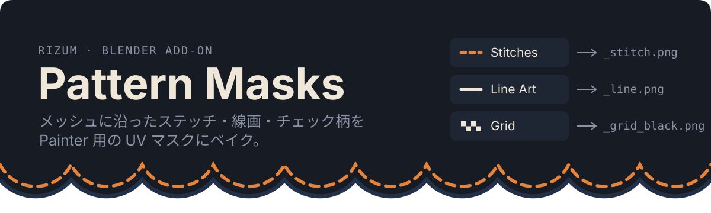
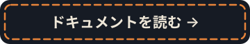
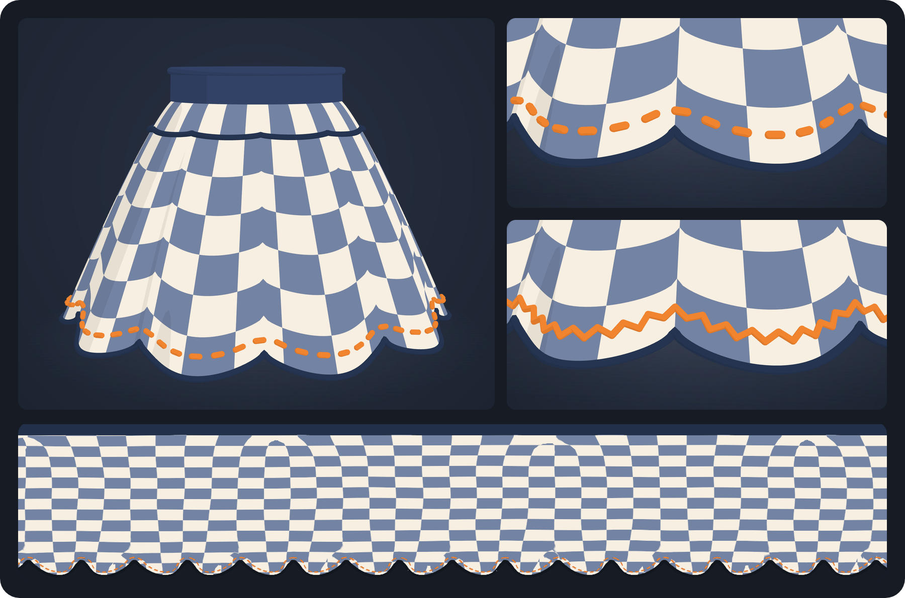

  

  <a href="./README.md">English</a> · <a href="./README.zh-CN.md">简体中文</a> · <b>日本語</b>

  

Blender でメッシュの辺をいくつか指定すると、Pattern Masks がその辺に沿ってステッチ・縁取り線・チェック柄を描きます。サイズはすべてモデル表面上の実寸（ミリ）で計算され、レイヤーごとに 16 ビットの UV マスク PNG としてベイクされます。Substance 3D Painter や CLIP STUDIO PAINT など、マスクを使えるソフトでそのまま使えます。

  

デモのスカートに付けた各種類のレイヤー：スカラップ裾に沿ったステッチ、裾の縁とウエストバンドの下の線画、チェック柄。右：ステッチの 2 つのスタイル、破線とジグザグ。下：UV 空間にベイクしたマスク。そのままペイントソフトで使えます。

## できること

- **ステッチ**（Stitches）：破線またはジグザグ。辺から布面に沿って測った一定の距離に置かれます。マークした角では尖った角になり、それ以外は滑らかにつながります。
- **線画**（Line Art）：モデル上のどこでも同じ実寸の太さの実線。辺ぴったりの縁取りから、辺から離れた帯まで。レイヤーはいくつでも追加できます。
- **チェック柄**（Grid）：マークした辺を起点に、メッシュのループに沿って敷く市松模様。濃い色のマスと薄い色のマスの 2 枚のマスクとしてベイクされます。

サイズは UV ではなく 3D の表面上で測るので、UV がどう伸びていても変わりません。

## 仕組み

1. **辺をマーク**：編集モードでレイヤーに沿わせたい辺を選び、そのレイヤーの Edges 行の **+** を押します。ループ、単独の辺、パスなど、どんな選択でも使えます。
2. **使い回す**：レイヤーは別のレイヤーを参照（Reference）して、その辺にも沿わせられます。複数のレイヤーで使う辺は一度マークするだけで済み、参照で受け取った辺のうち不要なものは個別に外せます。
3. **調整とプレビュー**：距離・太さ・長さ・マスの大きさを変えると、ビューポートのプレビューがその場で更新されます。
4. **ベイク**：レイヤーとテクスチャセットごとに PNG を 1 枚、`<オブジェクト>_<マテリアル>_<レイヤー>.png` という名前で書き出します。マスクはアンチエイリアス付きで、UV の継ぎ目の外側に少しはみ出させます。背景は黒（Painter 向け）か透明（2D ソフト向け）を選べます。

## インストール

Blender 4.4 以降が必要です（4.4 と 5.0 で動作確認済み）。

- **Blender から**（更新も届きます）：編集 › プリファレンス の **Get Extensions**（エクステンションを入手）› 右上の **Repositories**（リポジトリ）› **+** › **Add Remote Repository…**（リモートリポジトリを追加）を選び、`https://rizumu85.github.io/rizum-blender-pattern-masks/extensions/index.json` を貼り付けます。そのあと Get Extensions で *Pattern Masks* を検索してインストールします。
- **zip から**：[Releases](https://github.com/Rizumu85/rizum-blender-pattern-masks/releases)から `rizum_pattern_masks-<バージョン>.zip` をダウンロードし、Get Extensions の右上の ⌄ メニューから **Install from Disk…**（ディスクからインストール）を選びます。

## クイックスタート

アドオンの画面は日本語化されていないので、ボタン名は英語のままです。

1. UV のあるメッシュを選び、サイドバー（N）› **Pattern Masks** を開きます。
2. レイヤーリストの横の **+** から **Stitches** を追加します。
3. 編集モードで裾の辺を選び、**Edges** 行の **+** を押します。
4. プレビューを見ながら **From Edge**、**Length**、**Gap** を調整します。
5. .blend を保存してから **Bake Masks** を押します。マスクはファイルの横の `//stitch_masks/` に保存されます。
6. Painter で PNG をインポートし、グレースケールのマスクとして使います。たとえば糸の色で塗りつぶしたフィルレイヤーのマスクにします。

## 知っておくこと

- アドオンがメッシュに追加するのは辺と頂点の属性だけです。形状・ UV ・マテリアルは変更しません。
- モディファイアーを含まない元のメッシュを読みます。ミラーなどのモディファイアーは先にコピー上で適用して、Painter に渡すメッシュと一致させてください。
- **プリセット**：どのレイヤーの設定も名前を付けて保存できます。星を付けたプリセットが、その種類の新しいレイヤーの初期値になります。
- ベイクはバックグラウンドで進行バー付きで動くので、その間も Blender を使えます。
- **チェック柄の並べ方**：*Follow Loops* ではマスの大きさがすべて同じです。パーツが広がる部分では新しい列をどこかで始める必要があり、その始まりが小さな分かれ目として見えます。*Unrolled* には分かれ目がありませんが、裾に向かってマスが大きくなります。Unrolled は開いたパーツ向けで、閉じた筒状のパーツではマスが大きく歪みます。

[ドキュメントサイト](https://rizumu85.github.io/rizum-blender-pattern-masks/ja/)では、図と操作できるステッチの図ですべての機能を説明しています。[マニュアル](./docs/manual.md)（英語）は 1 ページにまとめた完全なリファレンスです。

## 開発

- `rizum_pattern_masks/` がアドオン本体です。
- `tests/` には Blender 内で実行するスクリプトがあります。例：`blender -b --factory-startup test/skirt_test.blend -P tests/grid_test.py -- <出力フォルダー>`。`tests/make_test_mesh.py` が `test/skirt_test.blend` を作ります。
- `python tests/run_all.py` は変更を出す前のチェックをまとめて実行します：テストスクリプト、Blender ウィンドウでのランダムな編集（エラー・クラッシュ・フリーズ）、`tests/perf_baseline.json` との処理時間の比較。
- `python build.py` は zip を `dist/` に書き出し、`python build.py --install` はさらに Blender 5.0 のエクステンションフォルダーにコピーします。
- `docs/source/` で README の画像とドキュメントサイトを作り直せます：`make_demo.py`（Blender 内でスカート・ベイク・レンダリング）、`make_svgs.py`（バナー・アイコン・図）、`proof/`（作例ボードのトゥーン調スカート）、`build_site.py`（`docs/content/` から `site/` を生成し、GitHub Pages で公開）。

## ライセンス

[GPL-3.0-or-later](./LICENSE) © 2026 Rizum

アドオン内のアイコン（`rizum_pattern_masks/icons.npz`、`tools/make_icons.py` で描画）は [CC0-1.0](https://creativecommons.org/publicdomain/zero/1.0/) で公開しています。
