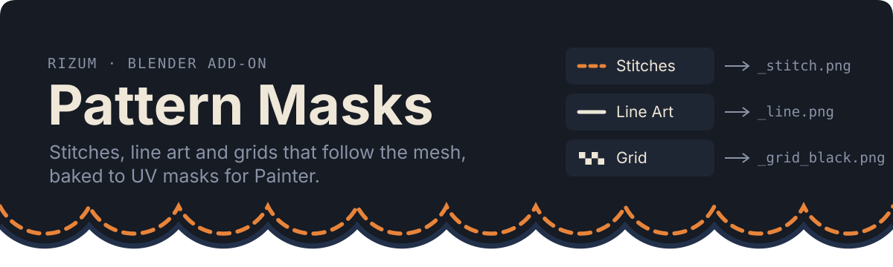
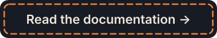
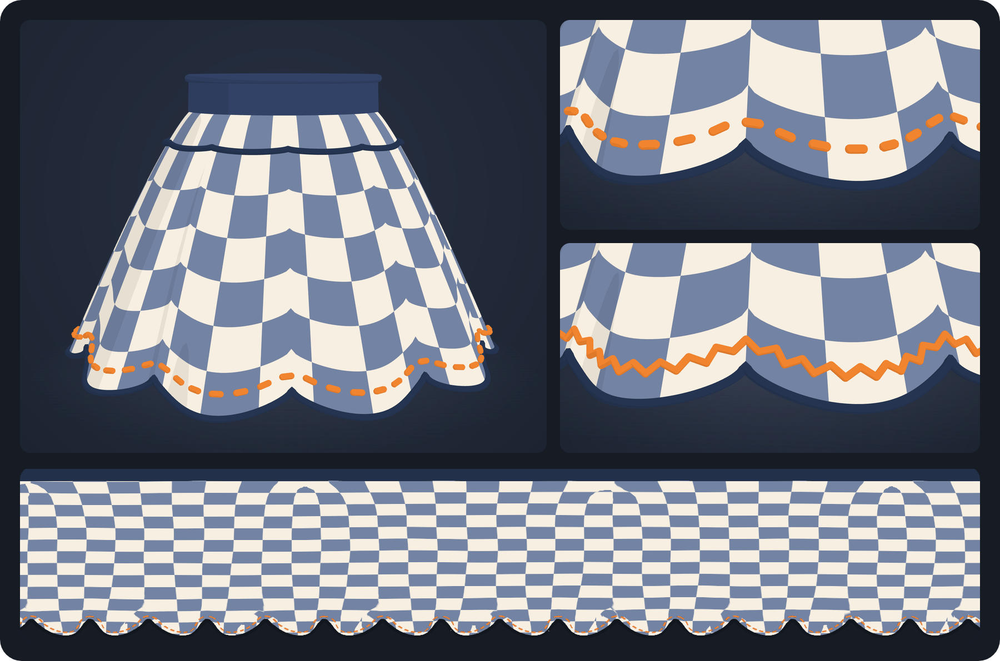

  

  <b>English</b> · <a href="./README.zh-CN.md">简体中文</a> · <a href="./README.ja.md">日本語</a>

  

Mark edges on a mesh in Blender, and Pattern Masks draws sewing stitches,
outlines and checks along them. It measures everything in real millimetres
on the surface, then bakes each layer to a 16-bit UV mask PNG for
Substance 3D Painter, Clip Studio Paint or any app that takes masks.

  

The demo skirt, textured with nothing but the baked masks: stitches on the
scalloped hem, a hem outline that references them, a waistband and a grid
laid from the waist. Right: the stitches follow each scallop and turn at the
points between them (grid hidden). Bottom: the same masks in UV space.

## What it makes

- **Stitches**: dashed or zigzag, a set distance in from the edge measured
  along the fabric. They run in sharp points into marked corners and round off
  elsewhere.
- **Line art**: solid lines of one real width everywhere, from an outline on
  the edge to a band further in. Add as many layers as you need.
- **Grid**: a checkerboard laid along the mesh's loops from a marked edge,
  baked as two masks, one for the dark squares and one for the light ones.

Sizes stay true however the UVs are stretched, because they are measured on
the 3D surface, not in UV space.

## How it works

1. **Mark edges.** In Edit Mode, select the edges a layer should follow and
   press **+** on its Edges row. Any selection works: loops, single edges or
   paths.
2. **Reuse them.** A layer can reference another layer and follow its edges
   too, so edges several layers need are marked once. It can also leave out
   any edges it gets that way.
3. **Tune and preview.** The preview updates in the viewport while you
   change distance, width, length or cell size.
4. **Bake.** One PNG per layer and texture set:
   `<object>_<material>_<layer>.png`. Masks are antialiased and bled past UV
   seams, and they go on a black background for Painter or a transparent one
   for 2D apps.

## Install

Requires Blender 4.2 or newer (tested on 5.0).

- **From Blender**: Edit › Preferences › Get Extensions, then search for
  *Pattern Masks*.
- **From a zip**: download `rizum_pattern_masks-<version>.zip` from
  [Releases](https://github.com/Rizumu85/rizum-blender-pattern-masks/releases),
  then in Get Extensions open the ⌄ menu at the top right and choose
  **Install from Disk…**.

## Quick start

1. Select a mesh that has UVs and open the sidebar (N) › **Pattern Masks**.
2. Press **+** next to the layer list and add **Stitches**.
3. In Edit Mode, select the edges along the hem, then press **+** on the
   **Edges** row.
4. Adjust **From Edge**, **Length** and **Gap** while you watch the preview.
5. Save the .blend, then press **Bake Masks**. The masks go to
   `//stitch_masks/` next to the file.
6. In Painter, import the PNG and use it as a grayscale mask, for example on a
   fill layer with the thread color.

## Good to know

- The add-on only adds edge and vertex attributes. It never changes the
  mesh's shape, UVs or materials.
- It reads the base mesh, without modifiers. Apply modifiers such as Mirror on
  a copy first, so the mesh matches what Painter gets.
- **Presets**: save the settings of any layer under a name. Star one to make it
  the default for new layers of that kind.
- The bake runs in the background with a progress bar, so Blender stays
  usable.
- **Grid layouts**: *Follow Loops* keeps every square the same size. Where a
  piece flares, new columns have to start somewhere, and each start shows as a
  small fork. *Unrolled* has no forks, but its squares grow towards the hem.
  It is meant for open panels; on a closed tube its squares come out large and
  distorted.

The [documentation site](https://rizumu85.github.io/rizum-blender-pattern-masks/en/) walks through every feature with pictures
and an interactive stitch diagram. The [manual](./docs/manual.md) is the full
reference in one page.

## Development

- `rizum_pattern_masks/` is the add-on.
- `tests/` holds scripts that run inside Blender, for example
  `blender -b --factory-startup test/skirt_test.blend -P tests/grid_test.py -- <out_dir>`.
  `tests/make_test_mesh.py` builds `test/skirt_test.blend`.
- `python build.py` writes the zip to `dist/`, and `python build.py --install`
  also copies it into Blender 5.0's extensions folder.
- `docs/source/` rebuilds the README images and the docs site: `make_demo.py`
  (the skirt, the bake and the renders, run in Blender), `make_svgs.py`
  (banner, icon and diagrams) and `build_site.py` (writes `site/` from
  `docs/content/`, published by GitHub Pages).

## License

[GPL-3.0-or-later](./LICENSE) © 2026 Rizum
