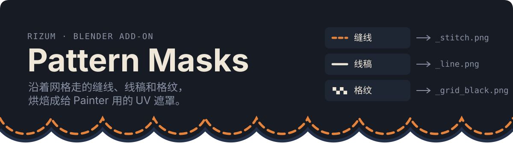
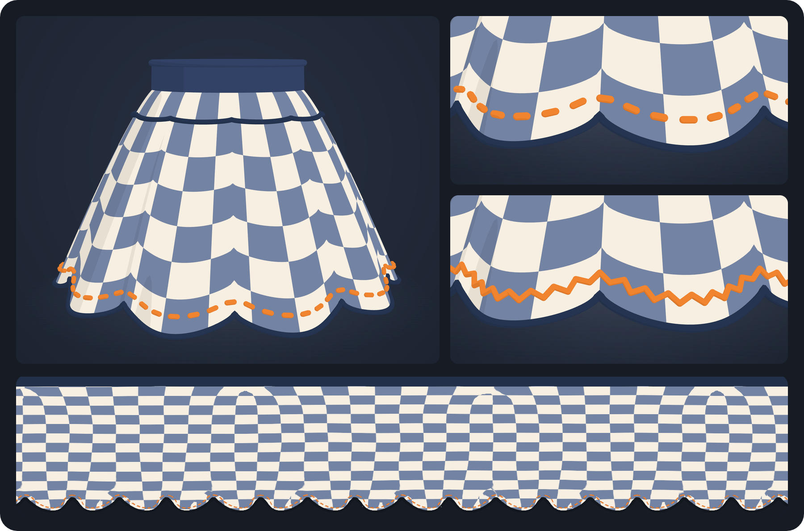

  

  <a href="./README.md">English</a> · <b>简体中文</b> · <a href="./README.ja.md">日本語</a>

  

在 Blender 里给网格标几条边，图案遮罩就会沿着它们画出缝线、描边和格纹。所有尺寸都按模型表面上的真实毫米计算，然后每一层烘焙成一张 16 位 UV 遮罩 PNG，可以直接拿去 Substance 3D Painter、Clip Studio Paint 等支持遮罩的软件用。

  

演示裙子上的每种图层：沿扇形下摆走的缝线、下摆边缘和腰头下方的线稿，以及格纹。右：两种缝线样式，虚线和锯齿。下：烘焙到 UV 空间里的遮罩，可以直接拿到绘图软件里用。

## 能做什么

- **缝线**：虚线或锯齿，离边固定距离，沿布面测量。遇到标记的尖角会走成尖角，其他地方圆滑过渡。
- **线稿**：在模型上处处同样实际宽度的实线，可以是贴边的描边，也可以是离边一段距离的色带。需要几层就加几层。
- **格纹**：从一条标记的边出发、顺着网格布线铺开的棋盘格，烘焙成深色格和浅色格两张遮罩。

尺寸在 3D 表面上测量，而不是在 UV 上，所以 UV 怎么拉伸，尺寸都不会变。

## 怎么用

1. **标边**：在编辑模式下选中这一层要走的边，点它"边"那一行的 **+**。什么样的选择都可以：循环边、单条边或路径。
2. **复用**：一层可以引用另一层，顺带走那一层的边，几层都要用的边只标一次。引用来的边里不需要的，也可以单独去掉。
3. **调整预览**：调离边距离、宽度、长度或格子大小时，视图里的预览会跟着更新。
4. **烘焙**：每一层、每个纹理集一张 PNG，命名为 `<物体>_<材质>_<图层>.png`。遮罩带抗锯齿，会越过 UV 接缝外扩一点。背景可选黑底（给 Painter）或透明（给 2D 软件）。

## 安装

需要 Blender 4.4 或更新版本（在 4.4 和 5.0 上测试过）。

- **在 Blender 里安装**（能收到更新）：编辑 › 偏好设置 › 获取扩展 › 右上角的**存储库** › **+** › **添加远程存储库…**，粘贴 `https://rizumu85.github.io/rizum-blender-pattern-masks/extensions/index.json`。然后在"获取扩展"里搜索 *Pattern Masks* 并安装。
- **用 zip 安装**：从 [Releases](https://github.com/Rizumu85/rizum-blender-pattern-masks/releases)下载 `rizum_pattern_masks-<版本>.zip`，然后在"获取扩展"右上角的 ⌄ 菜单里选**从磁盘安装…**。

## 快速上手

1. 选中一个有 UV 的网格，打开侧边栏（N）› **图案遮罩**。
2. 点图层列表旁的 **+**，添加 **缝线**。
3. 进编辑模式，选中下摆的边，点 **边** 那一行的 **+**。
4. 一边看预览，一边调 **离边距离**、**长度** 和 **间隔**。
5. 先保存 .blend，再点 **烘焙遮罩**。遮罩会存到文件旁边的 `//stitch_masks/`。
6. 在 Painter 里导入 PNG，当作灰度遮罩用，比如放在填充了缝线颜色的图层上。

## 需要知道的

- 插件只往网格上加边和顶点属性，不会改动网格形状、UV 和材质。
- 它读取的是不带修改器的原始网格。镜像之类的修改器请先在副本上应用，这样网格才和 Painter 拿到的一致。
- **预设**：任何一层的参数都可以存成预设。给某个预设点上星标，它就成了同类新图层的默认参数。
- 烘焙在后台进行，有进度条，期间 Blender 可以照常使用。
- **格纹排法**：*顺布线* 让每个方格大小一致；衣片变宽的地方要开始新的列，每个起点会出现一个小分叉。*展开* 没有分叉，但方格会往下摆方向逐渐变大。展开是为开口的衣片设计的，用在闭合的筒状衣片上，方格会变得很大而且变形。

[文档网站](https://rizumu85.github.io/rizum-blender-pattern-masks/zh-CN/)用图片和可交互的缝线示意图讲解每个功能。[手册](./docs/manual.md)（英文）是一页写全的完整参考。

## 开发

- `rizum_pattern_masks/` 是插件本体。
- `tests/` 是在 Blender 里运行的测试脚本，例如 `blender -b --factory-startup test/skirt_test.blend -P tests/grid_test.py -- <输出目录>`。`tests/make_test_mesh.py` 会生成 `test/skirt_test.blend`。
- `python tests/run_all.py` 是改动发布前的全部检查：测试脚本、在 Blender 窗口里随机编辑（报错、闪退、卡死），以及和 `tests/perf_baseline.json` 对比耗时。
- `python build.py` 把 zip 打包到 `dist/`，`python build.py --install` 还会把插件复制进 Blender 5.0 的扩展目录。
- `docs/source/` 用来重新生成 README 里的图片和文档网站：`make_demo.py`（在 Blender 里生成裙子、烘焙和渲染）、`make_svgs.py`（横幅、图标和示意图）、`proof/`（效果图上的卡通裙子）和 `build_site.py`（从 `docs/content/` 生成 `site/`，由 GitHub Pages 发布）。

## 许可

[GPL-3.0-or-later](./LICENSE) © 2026 Rizum

插件自带的图标（`rizum_pattern_masks/icons.npz`，由 `tools/make_icons.py` 绘制）以 [CC0-1.0](https://creativecommons.org/publicdomain/zero/1.0/) 发布。
